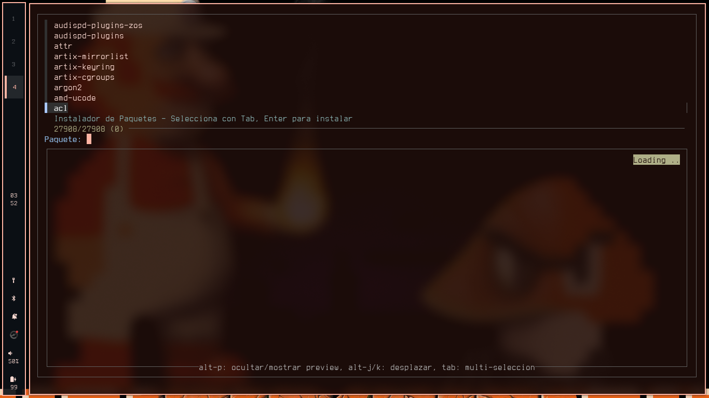
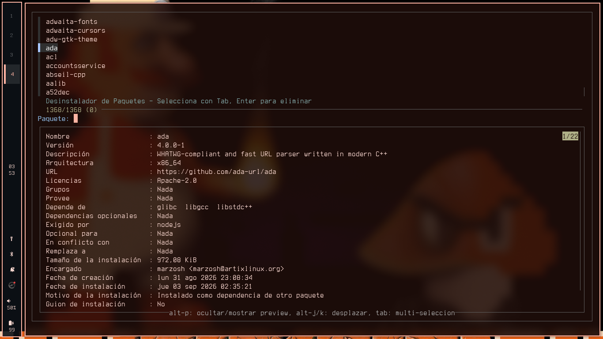

# pacman-tui

Un par de buscadores con fuzzy finder/fzf para instalar paquetes de **pacman** y del **AUR**, sin salirte de la terminal. Algo al estilo de las herramientas que trae Omarchy, pero con un toque más propio.

**pacfetch** lista todos los paquetes de los repos oficiales:



**aurfetch** hace lo mismo con el AUR, pero si tenés instalados *yay* y *paru* te deja elegir cuál usar:



## Qué hace

- **`pacfetch`** — Todos los paquetes de los repos, con preview de `pacman -Si` y multi-selección con `Tab`.
- **`aurfetch`** — Todo el AUR, con preview y `alt+b` para ver el PKGBUILD antes de instalar. Al elegir siempre te muestra el PKGBUILD y te pide confirmación, porque ya sabemos cómo es el AUR.
- **`pacman`** y **`paru`** — La función `pacman` reemplaza el comando real en tu shell y te da atajos:

| Comando | Qué hace |
|---|---|
| `pacman` | Abre el buscador de paquetes |
| `pacman update` | `pacman -Syu` |
| `pacman uninstall` | Te deja elegir qué desinstalar con fzf |
| `pacman uninstall <paquete>` | Lo borra directo |
| `paru` | Abre el buscador del AUR |

> Si en algún momento necesitás el pacman (o paru) de verdad, usá `command pacman` / `command paru`.

Todo en español, con bordes cuadrados y temas compartidos entre los tres buscadores.

## Instalación

```sh
git clone https://github.com/NateInkDemon3070/pacman-tui
cd pacman-tui
makepkg -si
```

Con el paquete, **fish** carga las funciones solo (van a `/usr/share/fish/vendor_functions.d/`). Para **bash** o **zsh** añadí a tu config:

```sh
source /usr/share/pacman-tui/pacman.bash   # o pacman.zsh
```

### Requisitos

- `fzf`, `pacman`, `curl`, `less`
- `yay` o `paru` (solo para el AUR)

## Créditos

Esto es un fork adaptado del proyecto de [kantiankant](https://github.com/kantiankant), [Omarchy_installers](https://github.com/kantiankant/Omarchy_installers), que a su vez porta los instaladores de [Omarchy](https://omarchy.org) de DHH. Gracias por el laburo previo. Licencia GPL-3.0.
